# BE Capstone Project

## Project Title

**Advanced SLI**

---

## Team Details

| Sr. No. | Name of Student | Roll No. | Branch | Email ID |
|---|---|---|---|---|
| 1 | Mohammed Salah Altaf Chogle | 41 | Automation & Robotics | 2023.mohammed.chogle@ves.ac.in |
| 2 | Ali Kalsekar | 53 | Automation & Robotics | d2024.ali.kalsekar@ves.ac.in |
| 3 | Aayush Kadam | 51 | Automation & Robotics | 2023.aayush.kadam@ves.ac.in |
| 4 |  |  |  |  |

---

## Guide Details

**Project Guide:** Gopalkrishnan Narayanan 
**Department:** Automation and Robotics  
**Institute:** VESIT, Mumbai  

---

## Problem Statement

> To compare the measured hook load with a rated-capacity chart in real time, warn the operator in stages, stop only the motions that would overload the crane while still allowing the motions that make it safer, and fall back to a safe state if a sensor fails. This must be done with affordable sensors and one embedded controller, and shown on a scale model of a low-capacity truck-mounted pick-and-carry crane.

---

## Abstract

Small truck-mounted pick-and-carry cranes usually work without a safe load indicator, so the operator judges the load and stability from experience alone. This project builds **Advanced SLI**, a safe load indicator for a scale-model truck-mounted crane with swing, boom-lift, telescopic and winch axes. It measures the hook load, boom angle and telescope extension, compares the load with a rated-capacity chart in real time, and stops only the motions that would make the lift unsafe, using hobby-grade parts and one embedded controller.

An ESP32 running FreeRTOS reads three AS5600 encoders on the stepper motors, an MPU6050 IMU and a 5 kg load cell with an HX711 at the boom tip, four force sensors under the outrigger pads and the N20 winch encoder. An Arduino Mega 2560 with a RAMPS 1.4 shield drives the three steppers. Every 20 ms the firmware looks up the rated load in an editable 2-D load chart (boom angle × extension, bilinear, up to four swing zones), works out the load percentage and sets the state to OK, WARN or CUT with a 2 % hysteresis. In the default ARMED mode each axis direction is checked one step ahead. Only directions that would reach the cut level without lowering the load percentage are blocked, so moves that reduce the load moment stay available. A missing chart, a failed sensor or an impossible load puts the system in FAULT, where only boom up, retract and rope pay-out are allowed. A latched emergency stop and a 400 ms dead-man stop work in every mode, without the PC. A FastAPI backend and a React dashboard show live values, edit and upload the chart, run calibrations and log sessions. A zero-vibration input shaper on the swing axis and an outrigger-based tipping margin were added as first advanced features.

On the crane, the motor-limited lifting capacity was measured (about 0.6 kg at full extension and 0.75–0.95 kg retracted) and used to build the first load chart. The SLI acceptance tests on the crane are not finished yet. The load is not yet corrected for the rope angle, the boom angle comes from the IMU, and there is no hardware emergency stop or limit switch. The system is an uncertified scale-model demonstrator, not a device for a real crane.

---

## Objectives

1. To study existing safe load indicators and load-moment limiters, and find the gap for low-capacity cranes.
2. To build a scale-model crane with swing, boom-lift, telescopic and winch axes as a test platform.
3. To design a sensor and control system for load, boom angle, extension, swing, rope length, outrigger force and motion.
4. To add load-chart limits with warning and cut levels, and a selective, predictive cut of unsafe motions.
5. To add a fault mode, a latched emergency stop and a dead-man stop that do not depend on the PC.
6. To provide a dashboard for monitoring, calibration, load-chart editing and logging.
7. To take first steps towards advanced features: swing anti-sway and a tipping-margin indicator.
8. To test the system on the scale model against its requirements.

---

## Scope of the Project

- Design and fabrication of a four-axis scale-model truck-mounted crane (swing, boom lift, telescope, winch)
- Sensor integration: 5 kg load cell (HX711), MPU6050 IMU, three AS5600 magnetic encoders, N20 winch encoder, four outrigger force sensors
- ESP32 FreeRTOS firmware for sensing and all safety decisions; Arduino Mega + RAMPS 1.4 for stepper control
- Browser dashboard with a FastAPI backend for live monitoring, load-chart editing, calibration and logging
- Safety software: 2-D load chart, selective predictive cut, fault mode, latched E-stop, dead-man stop
- First advanced features: ZV input shaping on swing, outrigger-based tipping margin
- Capacity measurement and acceptance testing on the scale model
- Out of scope for now: hydraulics, learned tipping prediction, operator scoring, use on a real crane

---

## Existing System

Large construction-grade cranes typically come with factory-fitted Rated Capacity Indicator (RCI) / SLI systems. However, small, local, truck-mounted pick-and-carry hydraulic cranes commonly used at smaller worksites usually operate without such systems.

Limitations of the current situation:

- High cost of commercial SLI systems relative to the value of low-capacity cranes
- Lack of retrofittable options for older or lower-capacity crane models
- Operators rely on experience/judgement rather than real-time load feedback
- No predictive safety features (e.g., sway or tipping warnings) on this crane category
- Limited accessibility of safety technology for smaller crane operators

---

## Proposed System

**Main idea:** An affordable safe load indicator that runs entirely on one microcontroller, developed and tested on a custom-built scale-model crane.

**How it works:** The ESP32 measures the hook load (load cell at the boom tip), boom angle (IMU), telescope extension, swing angle and rope length. Every 20 ms it looks up the rated capacity in a 2-D load chart and computes the load percentage. It warns at 90 % and cuts at 100 % by default. Each motion direction is checked one step ahead, and only the directions that would overload the crane are blocked, so the operator can always move the load back to safety. A fault mode, a latched E-stop and a dead-man stop work without the PC. The PC dashboard only shows values and forwards commands.

**Major components:** Four-axis scale-model crane, ESP32 (sensing and safety), Arduino Mega 2560 + RAMPS 1.4 (steppers), DRV8833 (winch), load cell + HX711, MPU6050, three AS5600 encoders, four FSRs, FastAPI backend and React dashboard.

**Expected benefits:** Real-time load awareness, motion cut before overload, safe moves always available, a low-cost architecture suited to smaller cranes, and a base for future predictive safety features.

**Changes from the proposal:** a load cell replaced the hydraulic-pressure measurement (the model has no hydraulics), a browser dashboard replaced PyQt6, and input shaping replaced PID anti-sway.

**Video** https://www.youtube.com/watch?v=u0mv6QGTxTg

---

## System Architecture


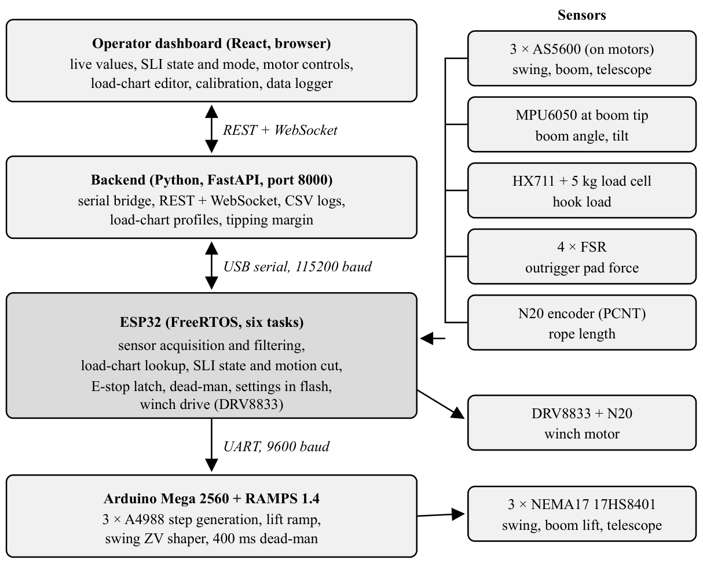


---

## Hardware Requirements

| Sr. No. | Component | Specification | Quantity | Purpose |
| ------- | --------- | ------------- | -------- | ------- |
| 1       | NEMA17 Stepper Motor | 17HS8401 | 3 | Swing, boom lift, telescopic extension actuation |
| 2       | N20 DC Gear Motor | 150 RPM, encoder-integrated | 1 | Winch (rope) drive |
| 3       | ESP32 | 30-pin dev board | 1 | Main controller: sensors, SLI logic, commands |
| 4       | Arduino Mega 2560 | — | 1 | Stepper executor (ramps, shaper, dead-man) |
| 5       | RAMPS 1.4 | — | 1 | Stepper driver shield |
| 6       | A4988 Stepper Driver | — | 4 (3 used) | Stepper motor driving |
| 7       | DRV8833 Motor Driver | — | 1 | N20 winch drive |
| 8       | AS5600 Magnetic Encoder | with magnet | 3 | Swing, boom and telescope motor rotation |
| 9       | MPU6050 IMU | 6-axis | 1 | Boom angle at the boom tip |
| 10      | HX711 + Load Cell | 5 kg | 1 | Hook load sensing at the boom tip |
| 11      | Force Sensing Resistor | RP-C18.3-ST | 4 | Outrigger pad forces (tipping margin) |
| 12      | Limit Switches | Mechanical | As required | Axis end-stop safety (planned) |
| 13      | 12V Power Supply | 12V, 10A | 1 | System power |

---

## Software Requirements

| Sr. No. | Software / Tool | Version | Purpose |
| ------- | --------------- | ------- | ------- |
| 1       | Arduino IDE / arduino-cli | IDE 2, ESP32 core 2.0.11 | Firmware development |
| 2       | Fusion 360      | —       | Mechanical CAD design |
| 3       | Python          | 3.x     | FastAPI backend, serial link, CSV logging |
| 4       | Node.js + React | React 19, Vite 8 | Browser dashboard |
| 5       | HX711 library (Rob Tillaart) | 0.6.3 | Load cell reading |

---

## Technologies Used

* Embedded C++ (Arduino framework) on ESP32 and Arduino Mega
* FreeRTOS (six tasks on two ESP32 cores)
* Software-controlled (bit-banged) I2C on four buses
* Complementary filter for the IMU boom angle
* Bilinear load-chart lookup with predictive, per-direction motion cut
* Zero-vibration (ZV) input shaping for swing anti-sway
* Python, FastAPI, WebSocket, pyserial (backend)
* React, TypeScript, Vite, Recharts (dashboard)
* CAD Design (Fusion 360), 3D printing and laser cutting

---

## Methodology

1. Literature survey: load-moment limiters, crane stability, sway control, low-cost sensing
2. Problem identification: small cranes lack an affordable SLI
3. Requirement analysis: 15 requirements with acceptance criteria
4. System design: ESP32 + Mega architecture, sensors, load chart and safety logic
5. Hardware/software development: crane mechanism, sensor sketches, firmware, backend, dashboard
6. Integration: firmware v2 (FreeRTOS, software I2C), SLI and load chart, capacity measurement
7. Testing and validation: crane acceptance tests T01–T14 (in progress)
8. Documentation and publication

---

## Project Timeline

| Week / Month | Task Planned          | Status                            |
| ------------ | --------------------- | --------------------------------- |
| Week 1       | Problem finalization  | Completed
| Week 2       | Literature survey     | Completed                                  |
| Week 3       | Requirement analysis  | Completed                                  |
| Week 4       | System design         | Completed                                  |
| Week 5       | Prototype development | Completed                                  |
| Week 6       | Testing               | In Progress                                  |
| Week 7       | Documentation         | In Progress                                  |
| Week 8       | Paper writing         | Pending                                  |

---

## Weekly Progress Updates

Students must update this section every week.

| Week   | Date | Work Completed | Work Planned for Next Week | Issues / Challenges | GitHub Commit Link |
| ------ | ---- | -------------- | -------------------------- | ------------------- | ------------------ |
| Week 1 | Feb 2026     | Finalized problem statement               |    Begin literature survey	                        |                     |                    |
| Week 2 | Mar 2026     | Literature survey               | Incorporate review feedback, finalize scope                           |                     |                    |
| Week 3 | Apr 2026     | Incorporated review feedback/modifications; finalized scope for submission               | Requirement analysis & component selection                           |                     |                    |
| Week 4 | Jul 2026     | Requirement analysis & component selection               |                            |                     |                    |
| Week 5 | Jul 2026     | Researched mechanical systems for prototype design               |                            |                     |                    |
| Week 6 | Jul 2026     | Mechanical design & 3D CAD modelling               |                            |                     |                    |
| Week 7 | Aug 2026     | 3D printing of mechanical parts and assembly               |                            |                     |                    |
| Week 8 | Aug 2026     | Prototype PCB and electronic configuration               |                            |                     |                    |
| Week 8 | Aug 2026     | Prototype testing done             | issues in model noted and updated laser cut files                           |                     |                    |
| Week 9 | Sep 2026     | Connections and electronics finalised | Sensor integration                           |                     | [5e25973](https://github.com/1tsMS/advanced_sli_BE_Project_2026_2027/commit/5e25973) |
| Week 10 | Sep 2026     | Test sketches for HX711, MPU6050, AS5600, FSR, N20 and both serial links | Firmware development                           |                     | [c3c4124](https://github.com/1tsMS/advanced_sli_BE_Project_2026_2027/commit/c3c4124) |
| Week 11 | Sep 2026     | First firmware (3 FreeRTOS tasks), Mega executor, FastAPI backend and dashboard; hook and outrigger CAD | Calibration & implement basic load-chart safety limits                           | Telescope read 110 mm for 30 mm of travel; winch ran in one direction only | [584ee0f](https://github.com/1tsMS/advanced_sli_BE_Project_2026_2027/commit/584ee0f) |
| Week 12 | Sep 2026     | Status report, reference papers; safety layer written on a separate branch | Build PyQt6 dashboard                           | Load cell and IMU not yet calibrated on the final crane | [cde4d75](https://github.com/1tsMS/advanced_sli_BE_Project_2026_2027/commit/cde4d75) |
| Week 13 | Oct 2026     | Review; safety branch set aside; 34-minute logged run; new T-nut lift joint; sensor problems analysed | 	Implement PID-based anti-sway control; begin tipping-prediction groundwork                           | ESP32 reset on every connect, tare lost, telescope reset to 0, swing read 10.9° for 90° | [f72da55](https://github.com/1tsMS/advanced_sli_BE_Project_2026_2027/commit/f72da55) |
| Week 14 | Oct 2026     | Firmware v2: 6 FreeRTOS tasks, software I2C on all buses, calibration in flash, dead-man motion; sensor hardening | 	Full system testing, bug fixes, results compilation, documentation                           | MPU6050 noise with the 12 V supply on | [e21fc42](https://github.com/1tsMS/advanced_sli_BE_Project_2026_2027/commit/e21fc42) |
| Week 15 | Oct 2026     | SLI with 2-D load chart, selective and predictive cut, modes and load-chart tab; ranges, rope geometry and lift capacity measured | Research paper writing                          | Winch spun while flashing (sleep pin); turntable plate tips under heavy load | [a0afede](https://github.com/1tsMS/advanced_sli_BE_Project_2026_2027/commit/a0afede) |
| Week 16 | Nov 2026     | Winch and telemetry refined; swing ZV shaper, tipping margin and lift recorder; Review 2 on 5 Nov ([feedback](docs/review2_evaluation_feedback.pdf)) | Crane validation tests; dashboard ergonomics and aesthetics (Review 2 feedback) | MPU noise: proto board rebuilt with JST connectors, π filter (15 Ω, 10 µF, 100 nF) and an inductor tried; still being resolved | [4a1f9b0](https://github.com/1tsMS/advanced_sli_BE_Project_2026_2027/commit/4a1f9b0) |
---

## Design Files

| File Type       | File Name / Link | Description |
| --------------- | ---------------- | ----------- |
| CAD Model       | [hardware/cad_model/V1](hardware/cad_model/V1) | STL, 3MF and DXF files of the crane parts |
| Circuit Diagram | [images/circuit_diagram.png](images/circuit_diagram.png), [hardware/connections.md](hardware/connections.md) | ESP32, Mega and sensor connections with GPIO numbers |
| PCB Design      | — | Prototype (perf) board, no PCB file |
| Flowchart       | [images/flowchart.png](images/flowchart.png) | Evaluation order of the ESP32 safety task |
| Simulation File |                  |             |

---

## Circuit Diagram

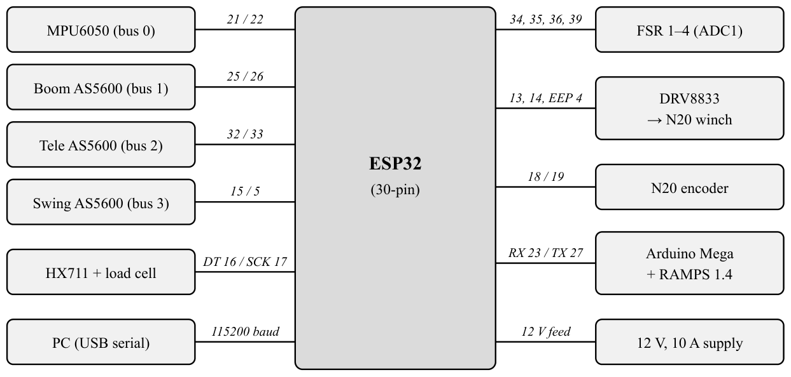

---

## Flowchart / Algorithm

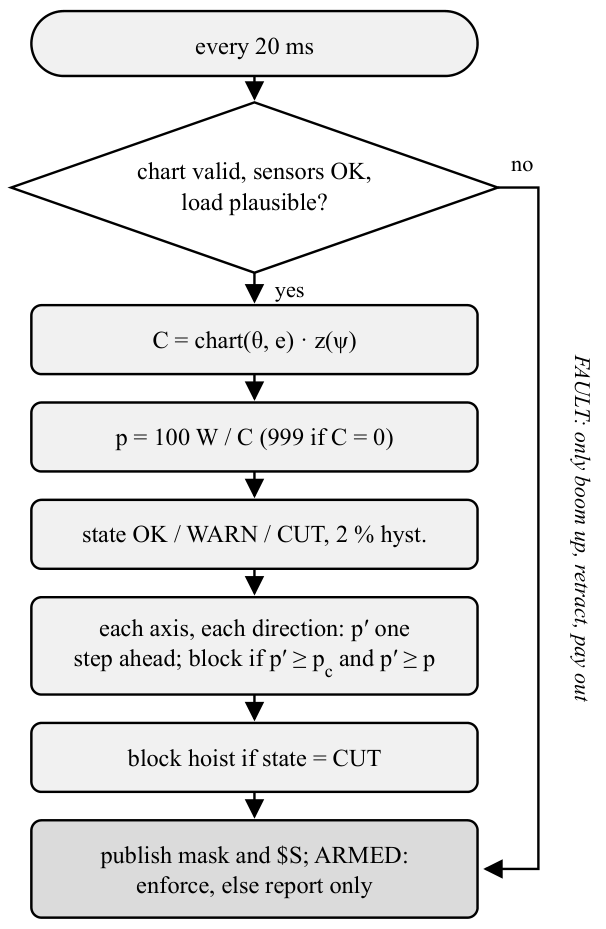

### Algorithm

1. Start: the ESP32 boots in ARMED mode, loads the calibration and load chart from flash and calibrates the gyro
2. Every 10 ms, read the load cell, encoders, IMU, FSRs and winch count
3. Every 20 ms, check for FAULT (no chart, sensor down, load above 10 kg or stale); in FAULT allow only boom up, retract and pay out
4. Otherwise look up the rated capacity in the 2-D chart and compute the load percentage
5. Set OK / WARN / CUT (90 % / 100 % by default, 2 % hysteresis)
6. For each axis and direction, compute the load percentage one step ahead; block it if it reaches the cut level without lowering the percentage
7. Refuse blocked commands, stop any moving axis that becomes blocked, and send `$T` (50 Hz) and `$S` (5 Hz) to the dashboard
8. E-stop latch (`T0` until `RST`), 400 ms dead-man and 3 s watchdog run in every mode

---

## Implementation Details

### Hardware Implementation

The swing axis is a NEMA17 with a 20:1 cycloidal reducer, on a turntable plate resting on four pillar bearings. The boom is raised by a self-locking leadscrew with a T-nut joint, and a second leadscrew moves the telescope (19.048 mm per motor turn, 22.4–67.4 mm). The N20 winch is fixed on the boom; the rope runs along the telescope and over the 5 kg load cell at the boom tip. The AS5600 encoders sit on the stepper motors, each on its own I2C bus, and the MPU6050 has a fourth bus, all with 4.7 kΩ pull-ups. Four FSRs under the outrigger pads use the ESP32's ADC1. The Mega drives the three steppers through A4988 drivers on a RAMPS 1.4; the ESP32 drives the winch through a DRV8833 whose sleep pin is on GPIO4. A 12 V supply powers the motors and the ESP32 is powered over USB. The electronics were rebuilt on a proto board with JST connectors, with a π filter on the IMU supply.

### Software Implementation

The ESP32 firmware (`software/firmware/esp32_mainv2`) runs six FreeRTOS tasks: sensors (100 Hz) and safety (50 Hz) on core 1; commands, serial output, the swing/boom/IMU bus (100 Hz) and flash storage on core 0. Each resource has one owner task. It talks to the PC over USB at 115200 baud and to the Mega over UART at 9600 baud using text commands (`M1`–`M4`, `T0`, `RST`, `SLI`, `LC`, `CAL0`–`CAL8`). The Mega program (`mega_executor`) steps the motors with a lift ramp, the swing ZV shaper and a dead-man. The FastAPI backend (`software/sli_desktop/backend`) streams telemetry over WebSocket, takes REST commands, logs CSV and stores chart profiles. The React dashboard (`software/sli_desktop/dashboard`) shows live values, hold-to-run controls, the load-chart editor with a range diagram, calibration tools and a lift recorder.

---

## Code Structure

````text
advanced_sli_BE_Project_2026_2027/
│
├── README.md
├── docs/
│   ├── project_status_report.md
│   ├── software_design_plan.md
│   ├── sensor_issues_2026-10-10.md
│   ├── review1_post_proposal_feedback.pdf
│   └── review2_evaluation_feedback.pdf
│
├── hardware/
│   ├── connections.md
│   ├── hardware.md
│   └── cad_model/V1/
│
├── software/
│   ├── firmware/
│   │   ├── esp32_mainv2/      (current ESP32 firmware)
│   │   ├── esp32_main/        (first firmware)
│   │   ├── mega_executor/     (Arduino Mega stepper executor)
│   │   └── host_tests/
│   ├── sli_desktop/
│   │   ├── backend/           (FastAPI)
│   │   └── dashboard/         (React + Vite)
│   └── test_codes/            (single-sensor test sketches)
│
├── images/
│   ├── system_architecture_v2.png
│   ├── circuit_diagram.png
│   ├── flowchart.png
│   ├── crane_*.webp
│   ├── dashboard_*.jpg
│   └── review2_geotag_*.jpg
│
└── reference/
    └── reference papers/
````

---

## How to Run the Project

### Step 1: Clone the Repository

````bash
git clone https://github.com/1tsMS/advanced_sli_BE_Project_2026_2027.git
````

### Step 2: Install Dependencies

````bash
pip install -r software/sli_desktop/backend/requirements.txt
cd software/sli_desktop/dashboard && npm install
````

Firmware needs the ESP32 Arduino core 2.0.11 and the HX711 library by Rob Tillaart (0.6.3).

### Step 3: Upload / Run the Code

````bash
cd software/sli_desktop/backend && python main.py
cd software/sli_desktop/dashboard && npm run dev
````

or

````bash
arduino-cli compile --fqbn esp32:esp32:esp32 software/firmware/esp32_mainv2
arduino-cli upload -p COMx --fqbn esp32:esp32:esp32 software/firmware/esp32_mainv2
arduino-cli upload -p COMy --fqbn arduino:avr:mega software/firmware/mega_executor
````

Unplug the 12 V winch supply while flashing the ESP32.

### Step 4: Observe the Output

Open the dashboard at `http://localhost:5173` and connect to the ESP32's COM port. Live telemetry updates at 50 Hz, the header shows the SLI state (OK / WARN / CUT / FAULT) and mode (ARMED / BYPASS / OFF), and a blocked motion is named with the moves that are still allowed. Upload a load chart from the Load Chart tab before lifting; with no chart the SLI stays in FAULT by design.

---

## Testing and Results

| Test No. | Test Description | Expected Result | Actual Result | Status      |
| -------- | ---------------- | --------------- | ------------- | ----------- |
| 1        | Maximum lift, telescope retracted, boom 7°, SLI off | Record the motor stall limit | 1000 g and 950 g | Measured |
| 2        | Maximum lift, telescope retracted, boom 12° | Record the motor stall limit | 900 g and 800 g | Measured |
| 3        | Maximum lift, telescope retracted, boom 53° | Record the motor stall limit | 750 g | Measured |
| 4        | Maximum lift, full extension, boom 0–50° | Record the motor stall limit | about 600 g | Measured |
| 5        | SLI acceptance tests on the crane (T01–T14: telemetry, IMU and load accuracy, chart, states, selective cut, FAULT, E-stop, dead-man, modes) | As per the test plan | — | Pending |

---

## Result Images / Videos

**Dashboard**

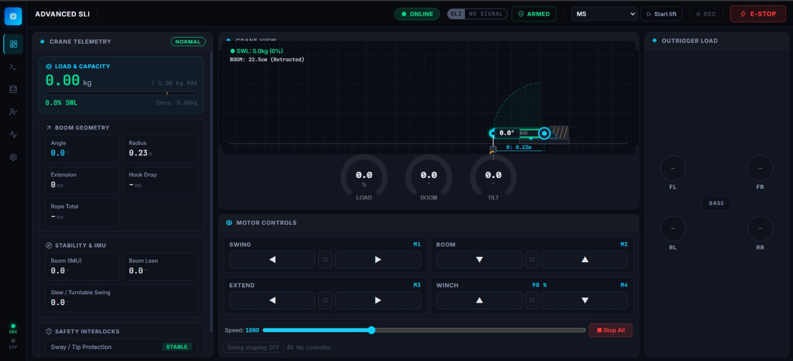
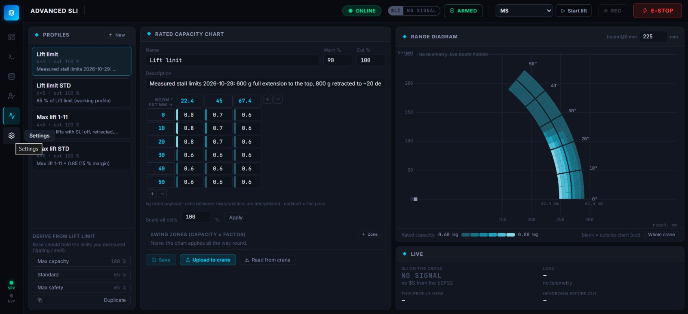
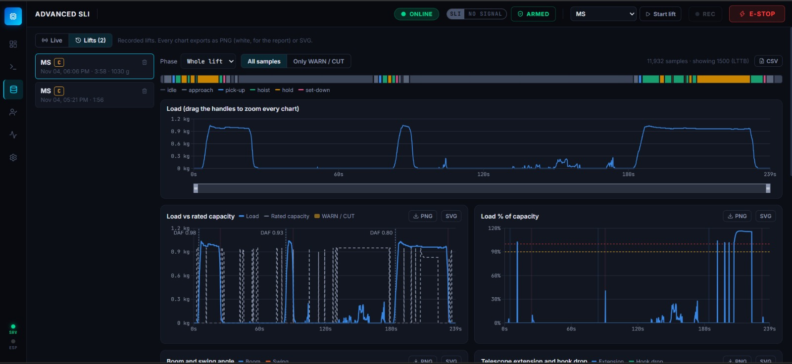

**Scale-model crane**

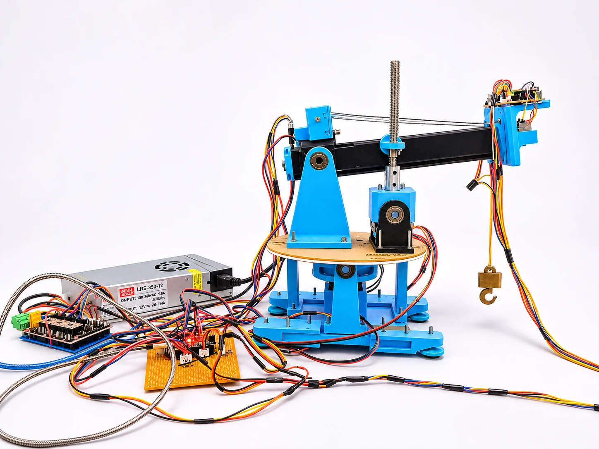
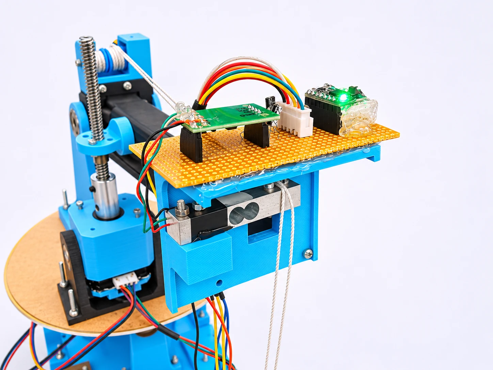
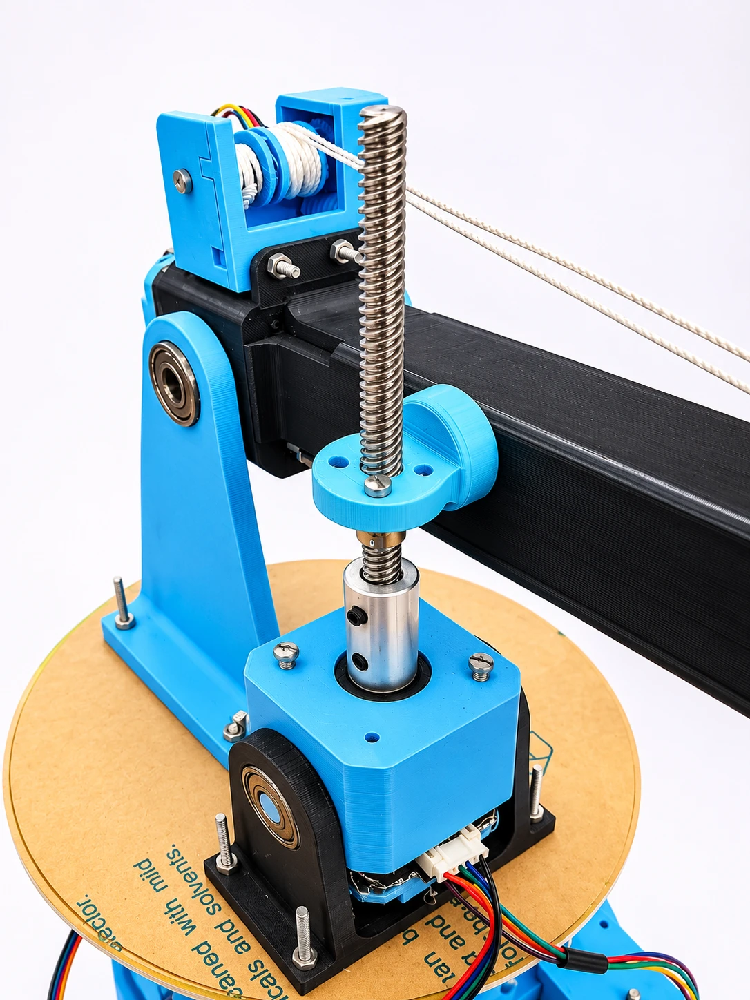
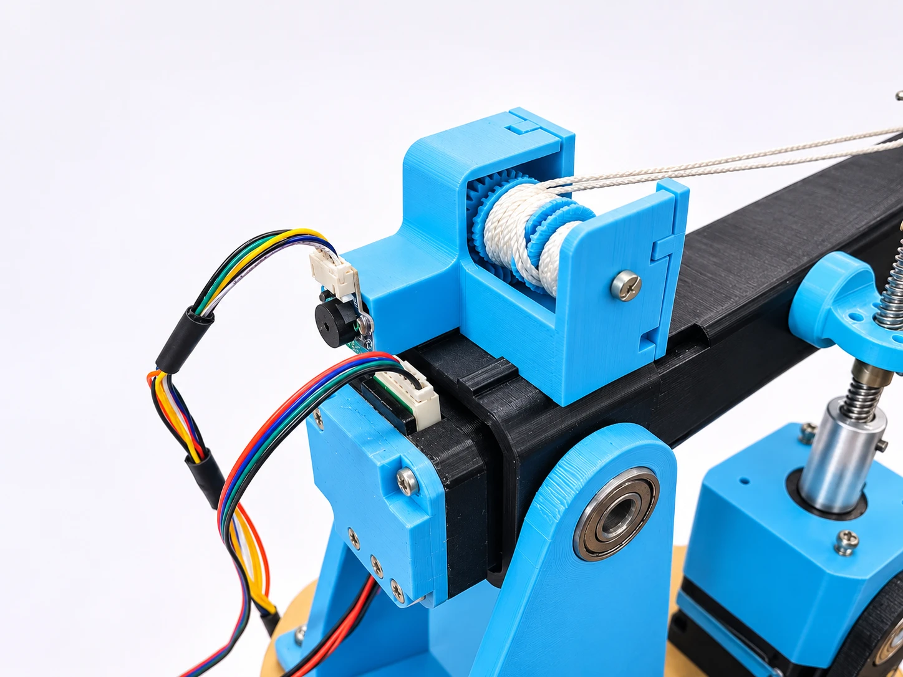

**Review 2 geotagged photos (5 Nov 2026)**

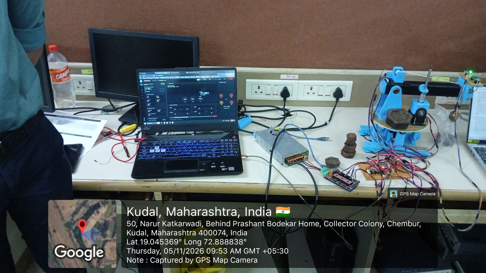
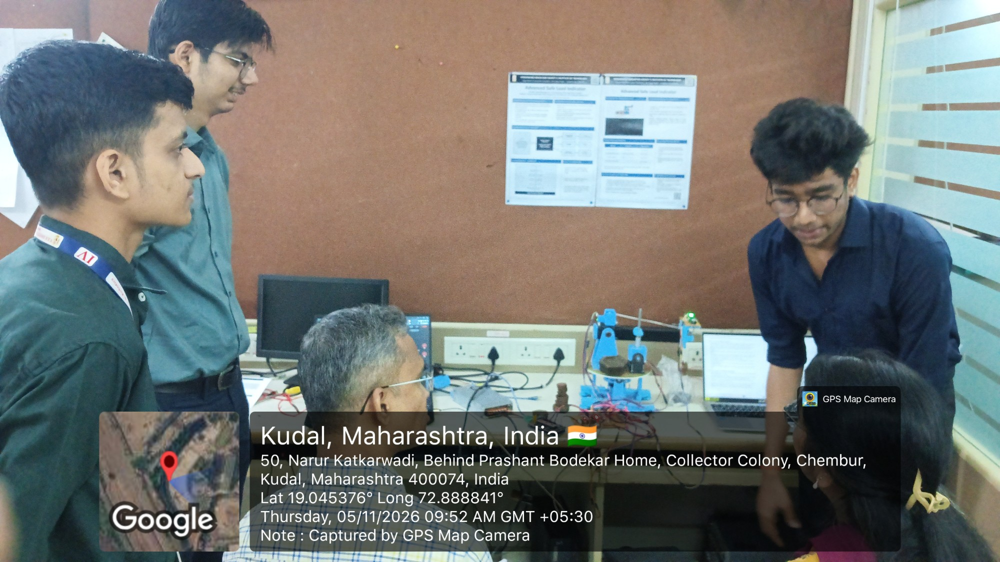
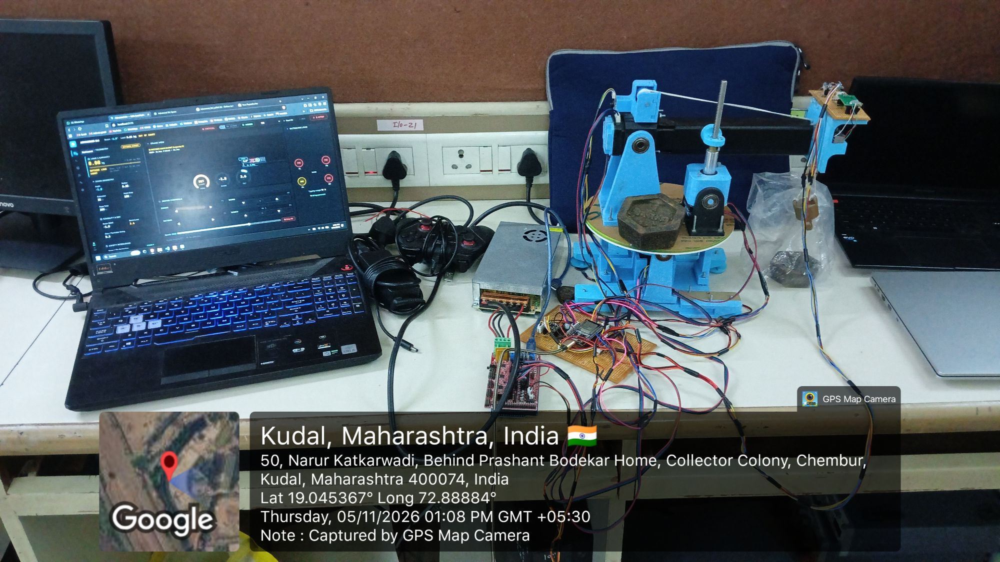
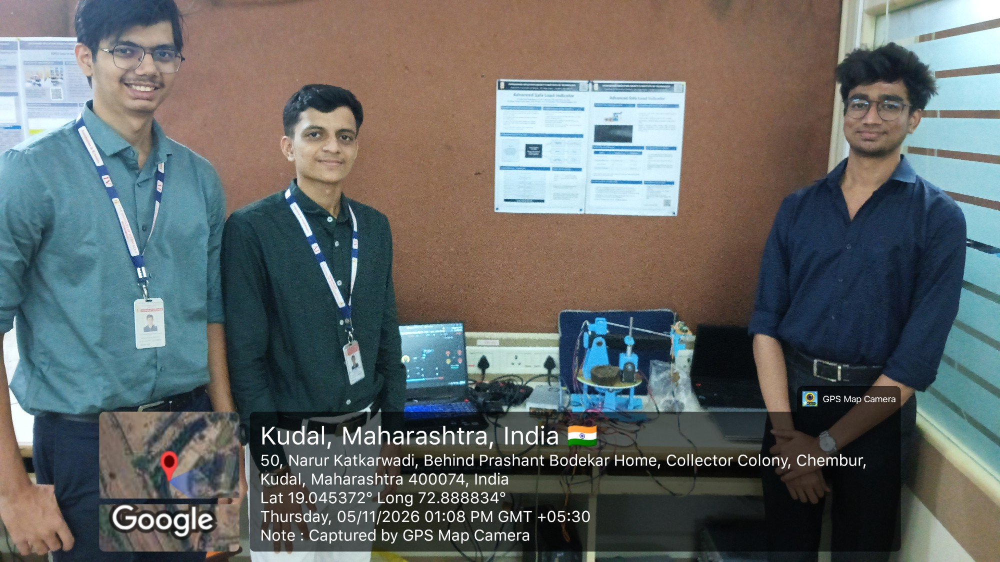

Video Link:

````markdown
[Project Demo Video](https://drive.google.com/your-video-link)
````

---

## Applications

1. Low-cost safe load indicator for small truck-mounted pick-and-carry cranes
2. Retrofit overload protection for older or low-capacity lifting equipment
3. Teaching and research platform for crane safety, load charts and anti-sway control
4. Test bed for crane control and monitoring algorithms before trying them on real cranes

---

## Advantages

1. Cuts only the unsafe motion directions, so moves that make the lift safer stay available
2. Stops a move one step before the limit instead of after it
3. All safety decisions and stops run on the ESP32 and work even if the PC stops
4. Low cost: hobby-grade parts, one microcontroller and an editable load chart

---

## Limitations

1. Crane acceptance tests are still pending; the chart is a motor stall limit, not a stability limit
2. The load is not yet corrected for the rope angle, and the boom angle comes from the IMU, which shows 1–2° of jitter with the 12 V supply on
3. All stops are in software; there is no hardware E-stop or limit switch yet
4. Scale model only: lifts under 1 kg, turntable plate not held down, not certified for real cranes

---

## Future Scope

1. Run the crane acceptance tests and improve dashboard ergonomics (Review 2 feedback)
2. Hardware E-stop on the 12 V supply, lift-axis limit switches, turntable hold-down rollers, pull-down on the winch driver's sleep pin
3. Rope-angle load correction, boom-encoder calibration cross-checked with the IMU, stability-based chart and tipping limit in the cut logic
4. Operator scoring, learned tipping prediction and trials on a real crane

---

## Research Paper / Publication

| Item                      | Details                                                   |
| ------------------------- | --------------------------------------------------------- |
| Paper Title               |                                                           |
| Conference / Journal Name |                                                           |
| Paper Status              | Not Started / Drafting / Submitted / Accepted / Published |
| Submission Date           |                                                           |
| Paper Link                |                                                           |

---

## References

````text
[1] V. Herrera-Pérez, F. Salguero-Caparrós, M. d. C. Pardo-Ferreira, and J. C. Rubio-Romero, "Key factors in crane-related occupational accidents in the Spanish construction industry (2012–2021)," Int. J. Environ. Res. Public Health, vol. 20, no. 22, Art. no. 7080, 2023.
[2] G. Kalairassan, M. Boopathi, and R. M. Mohan, "Analysis of load monitoring system in hydraulic mobile cranes," IOP Conf. Ser.: Mater. Sci. Eng., vol. 263, Art. no. 062045, 2017.
[3] S.-H. Noh et al., "Economical auto moment limiter for preventing mobile cargo crane overload," Sensors, vol. 20, no. 21, Art. no. 6355, 2020.
[4] R. Fukagawa, T. Muro, and K. Tanigami, "Evaluation of an alarm system to prevent the overturning of truck cranes," in Proc. 14th ISARC, Pittsburgh, PA, USA, 1997.
[5] N. Kaur, C. J. Adams, W. E. Singhose, and S. Devasia, "Mitigating dynamic tip-over during mobile crane slewing using input shaping," arXiv:2512.11228, 2025.
[6] Y. Fang, Y. K. Cho, and J. Chen, "A framework for real-time pro-active safety assistance for mobile crane lifting operations," Autom. Constr., vol. 72, pp. 367–379, 2016.
[7] J. Goh, Y. Fang, and B. Ens, "Embedded visualizations in crane operation user interfaces for real-time assistance," Autom. Constr., vol. 173, Art. no. 106078, 2025.
[8] T. Kusznir and J. Smoczek, "Soft-computing-based estimation of a static load for an overhead crane," Sensors, vol. 23, no. 13, Art. no. 5842, 2023.
[9] J. A. dos Reis, L. M. Vellame, L. B. Marinho, and I. S. T. Lordêlo, "A metrological assessment of the HX711 integrated circuit for enhancing lysimeter measurement accuracy," Sci. Agric., vol. 83, Art. no. e20240162, 2026.
[10] A. O. Garzón-Posada, L. Paredes-Madrid, A. Peña, V. M. Fontalvo, and C. Palacio, "Enhancing part-to-part repeatability of force-sensing resistors using a Lean Six Sigma approach," Micromachines, vol. 13, no. 6, Art. no. 840, 2022.
````

---

## Repository Update Guidelines

Each student team must update the GitHub repository regularly.

Minimum expected updates:

* Update README every week.
* Push code changes regularly.
* Upload circuit diagrams, CAD files, PCB files, reports and presentations.
* Add weekly progress in the progress table.
* Maintain proper folder structure.
* Do not upload unnecessary temporary files.
* Each major update should have a meaningful commit message.

Example commit messages:

````text
Added problem statement and objectives
Updated system architecture diagram
Added sensor interfacing code
Updated weekly progress for Week 3
Added testing results and prototype images
````

---

## Declaration

We declare that this project work is carried out by our team as part of the BE Capstone Project. The work will be regularly updated on GitHub and all references used will be properly cited.

---

## License

This project is for academic use only.

Optional:

````text
MIT License / Creative Commons / Institute Use Only
````

````
````
